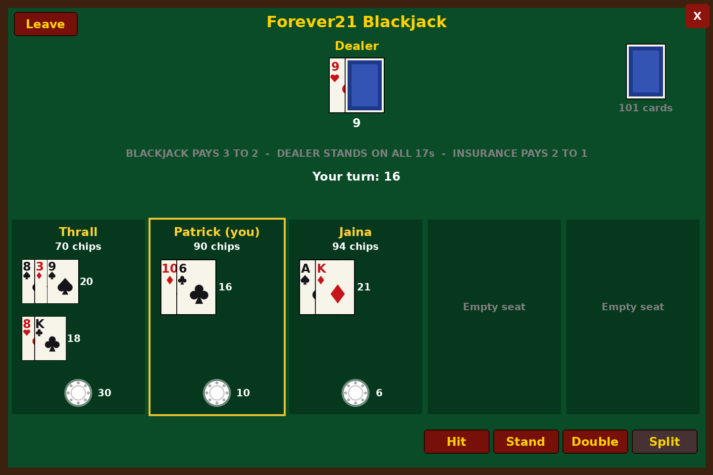
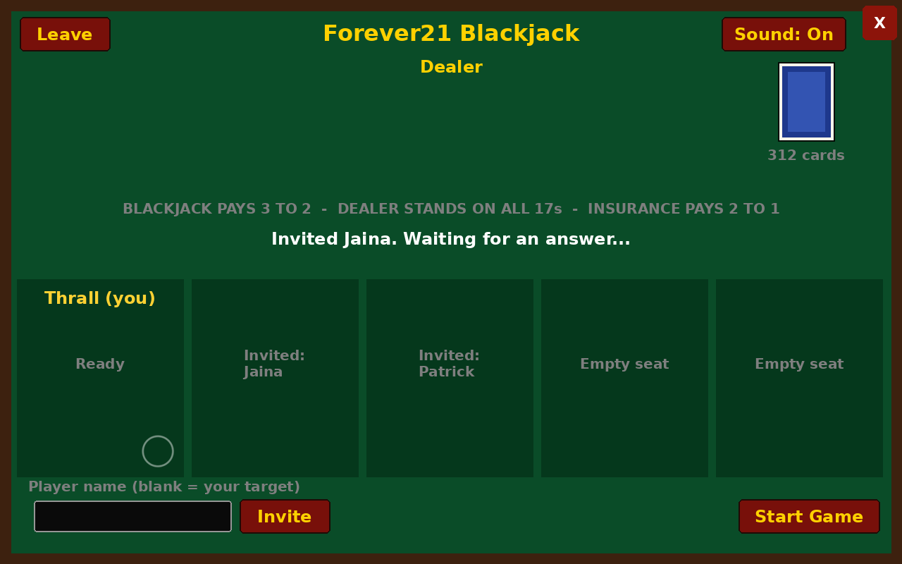

# Forever21

Blackjack for WoW Forever. Up to 5 players sit at a table and play against a dealer run by the addon. Everyone starts each game with 100 chips, and the last player with chips wins.

Built for WoW Forever 1.60.1 (addon interface 16001).



_Approximate render from `tools/preview.lua`; fonts and buttons look like WoW's own in game._

## Status

Milestone 3 of 5: multiplayer tables with invites, on top of the table window, sound effects, and solo play.

## Install

### With WowUp

1. In WowUp, pick your WoW Forever client, then go to **Get Addons** and choose **Install from URL**.
2. Paste `https://github.com/patrickpoulin/forever21` and install.

WowUp installs the latest GitHub release. A new release is published automatically whenever `main` has a new `## Version:` in `Forever21/Forever21.toc`.

### By hand

1. Copy the `Forever21` folder into `World of Warcraft/Interface/AddOns/` in your WoW Forever install.
2. Restart the game or type `/reload`.
3. Check it loaded with `/f21 api`.

## Play with friends

Everyone at the table needs Forever21 installed, and the same version. Nobody has to be in your party.

1. Type `/f21` and press **New Game**. You own the table and run the dealer.
2. Type a player's name in the box and press **Invite** (leave it blank to invite your target), or use `/f21 invite <name>`. Invite up to 4 players.
3. They get a popup and press **Accept**. Invites expire after 60 seconds.
4. Press **Start Game** when everyone is in. Anyone who hasn't answered yet is dropped.



Each round everyone has 20 seconds to bet, 15 seconds to answer insurance, and 30 seconds per turn. A player who runs out of time sits the round out, declines insurance, or stands. A player who drops below 2 chips is told they lose and stays at the table to watch. The game ends when one player has chips left, when everyone else leaves, or when the owner presses **Close Table**.

The owner's client runs the game and sends each player the table through hidden addon whispers, so the table stops if the owner logs out or reloads. Press **Leave** to clear it from your window.

## Play solo

Type `/f21` to open the table window and press **New Game**, then **Start Game** without inviting anyone. Set your bet with **-** and **+** (2 chips a step), type an amount in the box, or press **Max**, then press **Place Bet** to deal. Play with **Hit**, **Stand**, **Double**, and **Split**, and answer **Insure** or **No Insurance** when the dealer shows an ace. After each round a banner shows whether you won, lost, pushed, or busted and by how many chips, and every seat is outlined green, red, or yellow with its chips won or lost. Sound effects play for cards, bets, your turn, and results; turn them off with the **Sound** button or `/f21 sound`. Drag the window to move it; Escape closes it.

Everything also works from chat:

| Command | What it does |
| --- | --- |
| `/f21` | Show or hide the table window |
| `/f21 host` | Open a table you own |
| `/f21 invite <name>` | Invite a player (or your target) to your table |
| `/f21 start` | Start the game with everyone who has joined |
| `/f21 accept`, `/f21 decline` | Answer an invite |
| `/f21 solo` | Start a solo game with 100 chips |
| `/f21 bet <amount>` | Bet an even amount from 2 to 24 |
| `/f21 hit`, `/f21 stand`, `/f21 double`, `/f21 split` | Play your hand |
| `/f21 insure`, `/f21 noinsure` | Answer the insurance offer when the dealer shows an ace |
| `/f21 chips` | Show your chips |
| `/f21 quit` | Leave the game (the owner closes the table) |
| `/f21 sound` | Turn sound effects on or off |
| `/f21 chat` | Turn the chat messages on or off |
| `/f21 stats` | Your games and hands played |
| `/f21 api` | Show the version and which addon-message API this client has |

## Rules

6-deck shoe reshuffled at 75%, blackjack pays 3 to 2, dealer stands on all 17s and peeks for blackjack with an ace or ten showing. Insurance pays 2 to 1. Double on any two cards, including after a split. Split pairs up to 4 hands; split aces get one card each. Bets are even, from 2 to 24 chips. A player with fewer than 2 chips is out.

All rules live in `Forever21/Rules.lua`.

## Development

The card, rules, and game logic (`Cards.lua`, `Rules.lua`, `Game.lua`) are plain Lua with no game API calls, so they're tested outside the game.

```sh
sudo apt-get install lua5.1 lua-busted lua-check   # or: luarocks install busted luacheck
busted        # run the tests in spec/
luacheck .    # lint
```

GitHub Actions runs both on every push and pull request. `tools/wowstub.lua` stubs the game API and can load several copies of the addon as different players in one simulated room, with a fake clock and a fake whisper channel. `spec/ui_spec.lua` plays solo rounds through the window's buttons, and `spec/multiplayer_spec.lua` plays tables of up to 5 players, including invites, timeouts, and leaving.

To render approximate screenshots of the window outside the game:

```sh
lua5.1 tools/preview.lua /tmp/preview && python3 tools/render_preview.py /tmp/preview
```

Card suit and chip textures are drawn by `tools/make_media.py` (needs Pillow).
